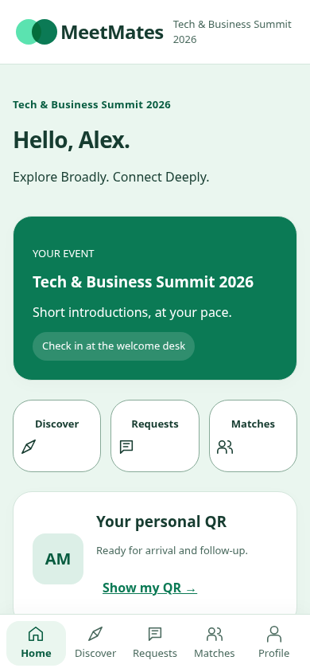
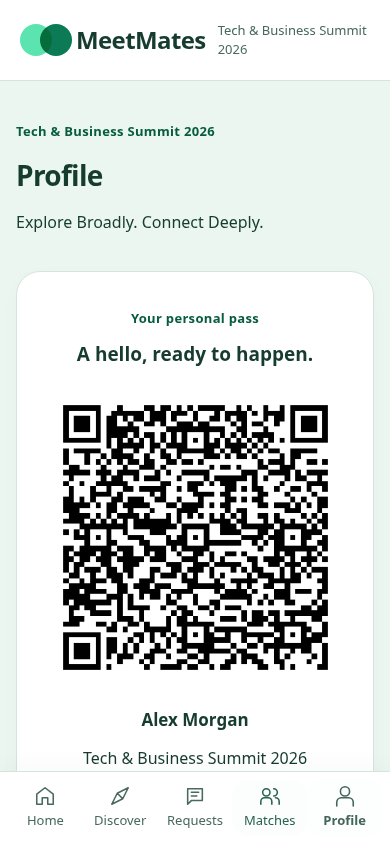
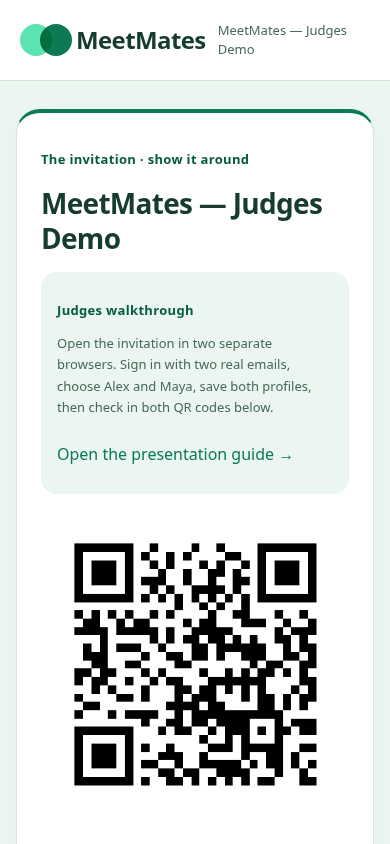
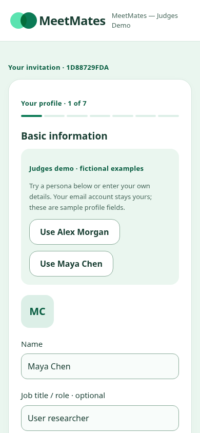
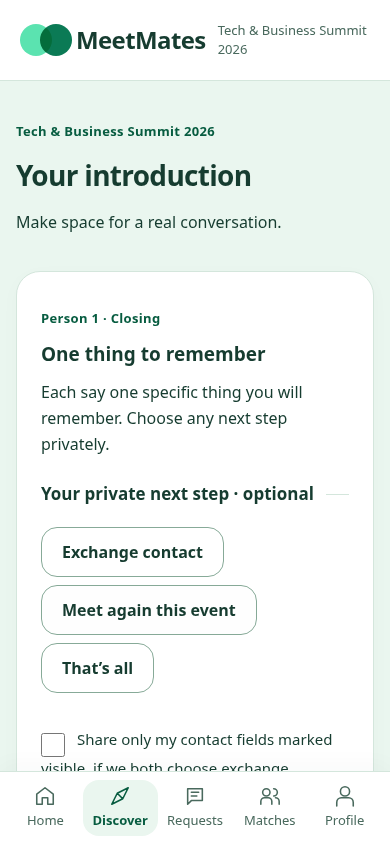

# Task 5A mobile screenshot gallery

38 screenshots, each exactly **390×844**. Captured from the actual Next UI with
real HTTP/PGlite handlers. Supabase credentials, OTP delivery and verification
are explicit test fixtures; these images are not evidence of a hosted login.
All people/event data and personal QR tokens here are disposable test examples.

The [validation report](../../Task5A-Validation.md) records the tests and limits.
Long forms/pages scroll; these images preserve the requested viewport rather
than stretching into full-page exports.

| Screen | Capture |
| --- | --- |
| Landing and event code | [01-landing.png](01-landing.png) |
| Email sign-in | [02-email.png](02-email.png) |
| One-time code | [03-code.png](03-code.png) |
| Profile: basic information | [04-profile-basic.png](04-profile-basic.png) |
| Profile: organization | [05-profile-organization.png](05-profile-organization.png) |
| Profile: background | [06-profile-background.png](06-profile-background.png) |
| Profile: interests | [07-profile-interests.png](07-profile-interests.png) |
| Profile: networking goals | [08-profile-goals.png](08-profile-goals.png) |
| Profile: mutual value | [09-profile-value.png](09-profile-value.png) |
| Profile: review | [10-profile-review.png](10-profile-review.png) |
| Optional binary preferences | [11-preferences.png](11-preferences.png) |
| Event Home | [12-event-home.png](12-event-home.png) |
| Discover in the shell | [13-discover.png](13-discover.png) |
| Requests in the shell | [14-requests.png](14-requests.png) |
| Matches and private history | [15-matches.png](15-matches.png) |
| Personal QR on Profile | [16-profile-qr.png](16-profile-qr.png) |
| Organiser event invitation | [17-organiser-invitation.png](17-organiser-invitation.png) |
| Organiser name-search fallback | [18-organiser-name-search.png](18-organiser-name-search.png) |
| Organiser scanned personal QR | [19-organiser-qr-scan.png](19-organiser-qr-scan.png) |
| Existing actionable attendee board | [20-discover-people.png](20-discover-people.png) |
| Existing invitation composer | [21-request-composer.png](21-request-composer.png) |
| Existing waiting state | [22-request-waiting.png](22-request-waiting.png) |
| Existing meeting point | [23-meeting-point.png](23-meeting-point.png) |
| Existing conversation cards | [24-conversation.png](24-conversation.png) |
| Existing private contact-consent closing | [25-close-contact-consent.png](25-close-contact-consent.png) |
| Existing private feedback | [26-feedback.png](26-feedback.png) |
| Organiser event creation | [27-organiser-create.png](27-organiser-create.png) |
| Existing meeting-point editor | [28-meeting-point-editor.png](28-meeting-point-editor.png) |
| Checked-in personal QR | [29-profile-checked-in.png](29-profile-checked-in.png) |
| QR-to-conversation follow-up | [30-qr-follow-up.png](30-qr-follow-up.png) |
| Created judges demo event | [31-judges-demo-event.png](31-judges-demo-event.png) |
| Fictional persona loaded into a real account | [32-demo-persona.png](32-demo-persona.png) |
| Demo persona review | [33-demo-persona-review.png](33-demo-persona-review.png) |
| Demo event Home | [34-demo-home.png](34-demo-home.png) |
| Judges presentation guide | [35-judges-guide.png](35-judges-guide.png) |
| Expired OTP recovery | [36-expired-code.png](36-expired-code.png) |
| Invalid invitation | [37-invalid-invitation.png](37-invalid-invitation.png) |
| Empty Discover board | [38-discover-empty.png](38-discover-empty.png) |

## Representative screens

